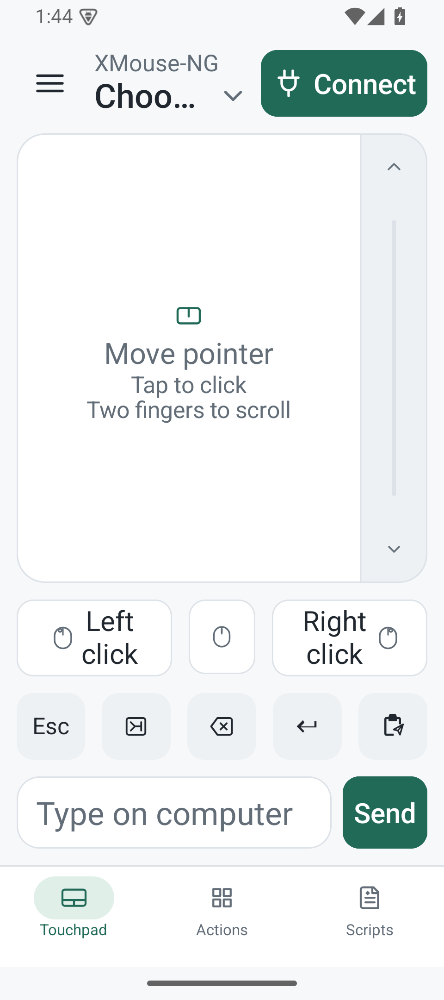
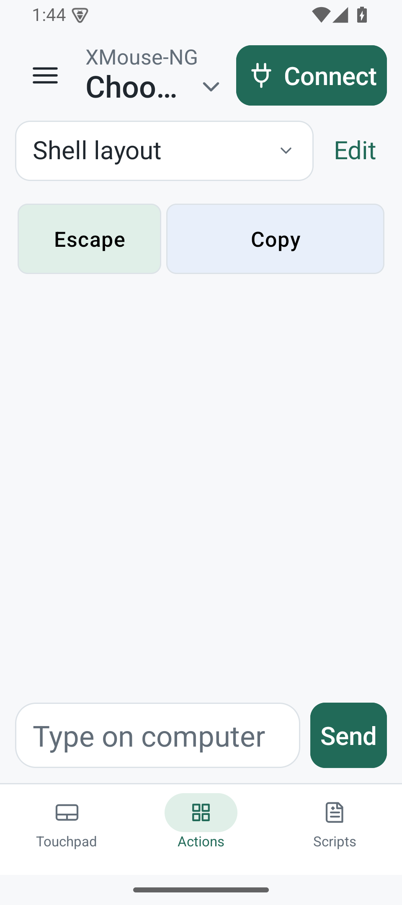

# XMouse-NG

Control a Linux desktop from an Android phone or tablet over SSH. XMouse-NG started as a fork of [bradand/XMouse](https://github.com/bradand/XMouse) and has grown into a redesigned native Android app.

## Screenshots

| Touchpad | Actions |
| --- | --- |
|  |  |

These captures use synthetic display data.

## Features

- Move and scroll the desktop pointer, click, use quick keys, and send text with the explicit **Send** action.
- Build named **Actions** layouts with custom shortcuts, or use the built-in key presets.
- Connect to Linux computers over SSH with password or private-key authentication and verify host fingerprints.
- Save and explicitly run SSH scripts; optionally discover SSH hosts on the local network.

Requires Android 8.0/API 26 or later and a Linux host with SSH plus `xdotool` (X11) or `ydotool` (Wayland).

## Download

Get the signed APK from the [latest GitHub release](https://github.com/homoludens/xmouse-ng/releases/latest). This release uses application ID `net.droopia.xmouse_ng` and installs separately from the earlier `com.stripe1.xmouse` app. Android does not transfer the old app's private data or credentials; keep it installed if you still need them and configure the new app separately. See the [release and upgrade guide](docs/releasing-xmouse-ng.md).

## Build

Use JDK 21 and Android SDK Platform 37 with Build Tools 36.0.0. Set `ANDROID_HOME` (and `ANDROID_SDK_ROOT`, if needed) to your SDK location, then run:

```sh
./gradlew :app:assembleDebug
./gradlew :app:testDebugUnitTest
```

The debug APK is written to `app/build/outputs/apk/debug/app-debug.apk`. A signed release build requires the maintainer's external signing configuration; never commit signing credentials.
